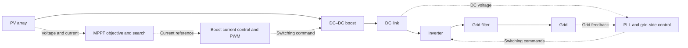

# Grid-connected PV: loss-aware MPPT under partial shading

**Stavros Stratakis · Diploma thesis · Power electronics & embedded control**

How do you find the best operating point of a photovoltaic system when shading creates multiple power peaks—and converter losses change which peak is most useful?

This project combines photovoltaic and converter modeling, Perturb & Observe (P&O) and Particle Swarm Optimization (PSO), grid-side control, and controller hardware-in-the-loop experiments. Its central finding is that **maximizing PV terminal power and maximizing power after losses can select different operating points**.

[Read the thesis in English](../Diploma%20Thesis%20-%20English.pdf) · [Greek edition](../Diploma%20Thesis%20-%20Greek.pdf) · [Results & evidence](docs/results.md) · [Explore the implementation](docs/implementation.md)

> **Preview edition.** This folder offers an alternative presentation of the existing thesis repository. All models, algorithms, reports and thesis PDFs remain in their original locations.

## At a glance

| Engineering question | Work documented in the repository |
| :--- | :--- |
| How does shading affect the PV operating point? | I–V and P–V characterization, including bypass diodes and multiple power peaks |
| How should the operating point be selected? | Current-reference P&O and PSO, with PV-power and loss-aware objectives |
| How is the array connected to the grid? | Boost converter, DC link, inverter, synchronization and current control |
| Does the control behavior carry over to real time? | Typhoon HIL402 experiments with a TI Delfino F28379D LaunchPad |

## System and control

In the documented HIL setup, the power stage is simulated in real time. The LaunchPad controls the boost stage; the inverter control is implemented within the Typhoon HIL schematic. This provides a bridge between offline simulation and embedded control evaluation.

## Featured result: the objective matters

*Original repository figure, reproduced by reference. The legend's “Losses” and “No Losses” distinguish the MPPT objective used in the comparison.*

The loss-aware case selects a lower-current operating region and produces higher real power in this partial-shading comparison. The thesis reports an improvement of **up to approximately 5% in the studied cases**; this is a scenario-specific result, not a guaranteed gain under all operating conditions. [See the evidence and interpretation](docs/results.md).

Three conclusions guide the work:

- **P&O is useful under uniform irradiance**, with a smooth response in the reported HIL irradiance-change test. Under partial shading, the first peak it reaches need not be the best one.
- **PSO explores multiple peaks**, but searching globally still requires the right objective: a PV-power optimum can differ from the loss-aware optimum.
- **Control and optimization must work together.** The study also examines DC-link regulation and reactive-power response, alongside MPPT behavior.

## Explore the project

| Start here | What you will find |
| :--- | :--- |
| [Results & evidence](docs/results.md) | Selected simulation and HIL figures, scenario comparisons and thesis page references |
| [Implementation guide](docs/implementation.md) | Exact model filenames, algorithm interfaces and embedded-control assets |
| [Reproduction guide](docs/reproduction.md) | Saved model releases, a practical inspection workflow and rerun prerequisites |
| [English thesis](../Diploma%20Thesis%20-%20English.pdf) / [Greek thesis](../Diploma%20Thesis%20-%20Greek.pdf) | Full derivations, methodology and experimental discussion |
| [Original report collection](../Reports) | Complete uploaded figure collection |

**Technical scope:** MATLAB/Simulink · PV modeling · DC–DC conversion · grid-connected inverters · MPPT · P&O · PSO · TI C2000 · Typhoon HIL.

[About this preview](REVIEW-NOTES.md) · [Repository license](../LICENSE)
