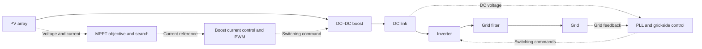

# Grid-connected PV: loss-aware MPPT under partial shading

**Stavros Stratakis · Diploma thesis · Power electronics & embedded control**

A partially shaded solar array can have several operating points that look optimal. Choosing the point with the highest panel power does not necessarily deliver the most useful power to the grid, because conversion losses also matter.

This thesis investigates that problem through modeling, control implementation and real-time experiments. It compares two maximum power point tracking (MPPT) methods—Perturb & Observe (P&O) and Particle Swarm Optimization (PSO)—within a grid-connected photovoltaic (PV) system. Its central finding is that **maximizing PV terminal power and maximizing power after losses can select different operating points**.

[Read the thesis in English](../Diploma%20Thesis%20-%20English.pdf) · [Greek edition](../Diploma%20Thesis%20-%20Greek.pdf) · [Results & evidence](docs/results.md) · [Explore the implementation](docs/implementation.md)

## Engineering work demonstrated

| Area | Work in the thesis | Explore the evidence |
| :--- | :--- | :--- |
| **System modeling** | Model the PV array, boost converter and grid-connected inverter; extract I–V and P–V characteristics to identify candidate operating points | [Models and source files](docs/implementation.md#models-and-hardware-assets) |
| **Control design** | Combine MPPT current references with boost current control, inverter voltage/current loops and PLL synchronization | Thesis pp. 104–106; [system overview](#system-and-control) |
| **Algorithm implementation** | Implement and compare P&O and PSO using PV-power and loss-aware objectives | [MATLAB functions and interfaces](docs/implementation.md#algorithm-interfaces) |
| **Experimental evaluation** | Compare simulation behavior with controller hardware-in-the-loop current traces using TI C2000 and Typhoon HIL | [HIL scenarios and traces](docs/results.md#3-controller-hardware-in-the-loop) |

The workflow moves from **characterizing the plant → implementing control → comparing scenarios → evaluating the controller in real time**. The repository includes the model files, algorithm sources, HIL assets and reported results behind that process.

**For a quick review:** start with the result below, then open the [implementation guide](docs/implementation.md) for the code and model structure. The [full thesis](../Diploma%20Thesis%20-%20English.pdf) provides the derivations and experimental detail.

## System and control

In the documented HIL setup, the power stage is simulated in real time. The LaunchPad controls the boost stage; the inverter control is implemented within the Typhoon HIL schematic. Hardware-in-the-loop (HIL) means the physical controller interacts with a simulated electrical plant, allowing its behavior to be evaluated in real time.

## Featured result: the objective matters

*Original repository figure, reproduced by reference. The legend's “Losses” and “No Losses” distinguish the MPPT objective used in the comparison.*

The loss-aware case selects a lower-current operating region and produces higher real power in this partial-shading comparison. The thesis reports an improvement of **up to approximately 5% in the studied cases**; this is a scenario-specific result, not a guaranteed gain under all operating conditions. [See the evidence and interpretation](docs/results.md).

### Selected study details

| Detail | Reported value | Context |
| :--- | :--- | :--- |
| DC-link voltage target | **1200 V** | Grid-connected simulation; thesis pp. 103, 119 |
| Offline discrete simulation step | **10 µs** | Model described on p. 103; not a claimed controller execution time |
| Uniform-irradiance test | **800 → 1000 → 900 W/m²** | Five-second simulation with ramps; p. 116 |
| PSO operating-current comparison | **≈45 A → ≈28 A** | PV-power versus loss-aware objective under the studied partial shading; p. 135 |

[See the test profile, numerical context and source references](docs/results.md).

Three conclusions guide the work:

- **P&O is useful under uniform irradiance**, with a smooth response in the reported HIL irradiance-change test. Under partial shading, the first peak it reaches need not be the best one.
- **PSO explores multiple peaks**, but searching globally still requires the right objective: a PV-power optimum can differ from the loss-aware optimum.
- **Control and optimization must work together.** The study also examines DC-link regulation and reactive-power response, alongside MPPT behavior.

## Explore the project

| Start here | What you will find |
| :--- | :--- |
| [Results & evidence](docs/results.md) | Selected simulation and HIL figures, scenario comparisons and thesis page references |
| [Implementation guide](docs/implementation.md) | Exact model filenames, algorithm interfaces and embedded-control assets |
| [Reproduction guide](docs/reproduction.md) | Saved model releases, a practical inspection workflow and rerun prerequisites |
| [English thesis](../Diploma%20Thesis%20-%20English.pdf) / [Greek thesis](../Diploma%20Thesis%20-%20Greek.pdf) | Full derivations, methodology and experimental discussion |
| [Original report collection](../Reports) | Complete uploaded figure collection |

**Technical scope:** MATLAB/Simulink · PV modeling · DC–DC conversion · grid-connected inverters · MPPT · P&O · PSO · TI C2000 · Typhoon HIL.

[Preview edition — scope and review notes](REVIEW-NOTES.md) · [Repository license](../LICENSE)
