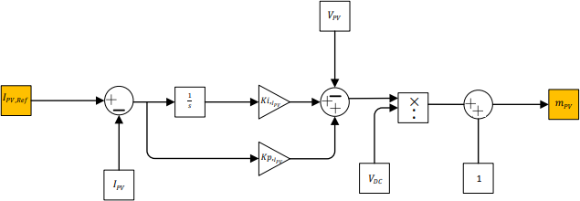
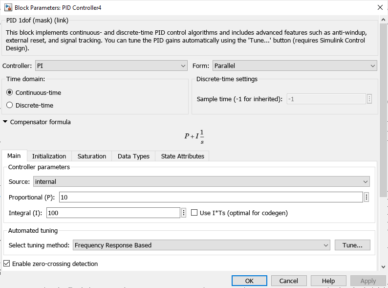
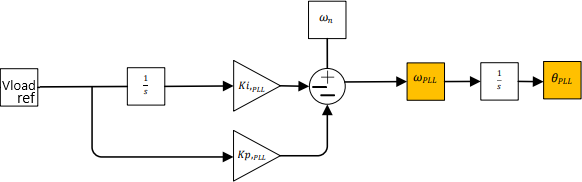
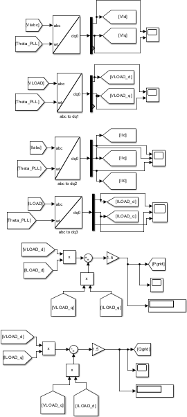
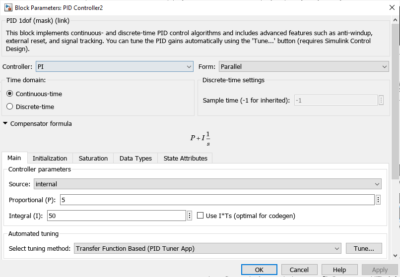
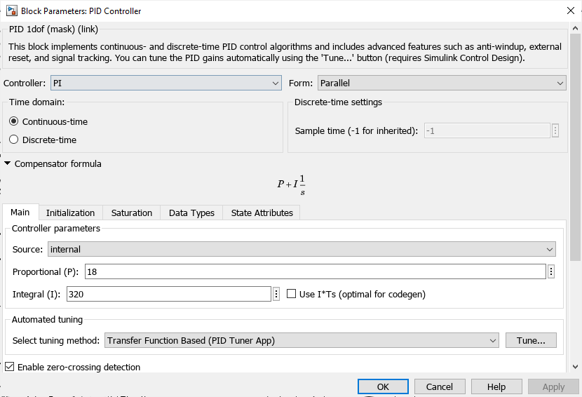
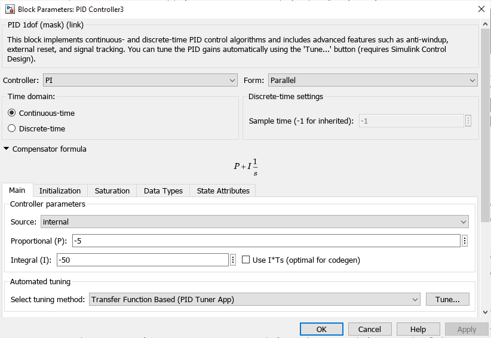
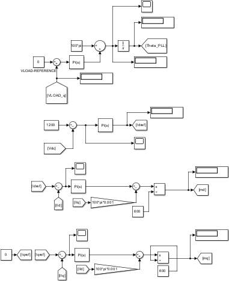

# Control design and PI tuning

[← Engineering walkthrough](engineering.md) · [C2000 & HIL integration](embedded-hil.md)

The design separates **operating-point selection** from **electrical regulation**. MPPT selects a PV current reference; the boost current loop tracks it. The grid-side controller uses a rotating reference frame, a PLL and cascaded voltage/current loops. This page documents the analytical tuning rules and the actual parameter screenshots in Chapter 4.

## 1. Boost current loop: from the plant equation to duty ratio

With the thesis notation, the averaged DC-side equation is

$$L\frac{di_{pv}}{dt}+R_{eq}i_{pv}=V_{pv}-(1-m_{pv})V_{dc}.$$

Define the current error and PI output as

$$e_i=i_{pv,ref}-i_{pv},\qquad u_i=K_p e_i+K_i\int e_i\,dt.$$

The control law shown on pp. 71–72 is

$$m_{pv}=1+\frac{u_i-V_{pv}}{V_{dc}}.$$

Substituting this law into the averaged plant gives $L\dot i_{pv}+R_{eq}i_{pv}=u_i$. This explains the voltage compensation and normalization blocks: they reduce the current-control design to an RL plant driven by the PI output.

*Figure 31, p. 72. The current reference comes from MPPT; measured PV and DC-link voltages enter the duty calculation.*

### Analytical gain selection

The thesis specifies

$$K_p=\frac{L}{T_{i,pv}},\qquad K_i=\frac{R_{eq}}{T_{i,pv}}.$$

For the ideal compensated plant, the closed-loop expression can be written as

$$\frac{I_{pv}(s)}{I_{pv,ref}(s)}=\frac{K_p s+K_i}{L s^2+(R_{eq}+K_p)s+K_i}.$$

Substituting the stated gains and cancelling the common RL factor yields

$$\frac{I_{pv}(s)}{I_{pv,ref}(s)}=\frac{1}{T_{i,pv}s+1}.$$

The last two expressions make the tuning rule explicit: $T_{i,pv}$ sets the ideal closed-loop time constant. This algebraic interpretation assumes the averaged model and its compensation; it is not a measured bandwidth or a claim that switching, sampling and saturation disappear.

*Figure 35, p. 77: the reported boost PI settings are **Kp = 10, Ki = 100**, in parallel, continuous-time form.*

## 2. Synchronization and rotating-frame measurements

*Figure 32, p. 74: PI correction of angular frequency, followed by integration to obtain angle.*

The PLL orients the rotating frame by driving the grid-voltage q component toward its reference, normally zero. Integrating angular frequency gives $\theta_{PLL}$, which is passed to the Park transformations. The angle is the transformation input; frequency alone is not sufficient.

*Figure 59, measurement portion, p. 105. The model transforms measured voltages and currents and calculates active and reactive power in the dq frame.*

*Figure 36, p. 78: **Kp = 5, Ki = 50** for the PLL PI shown in the thesis.*

## 3. Grid-side current loops and decoupling

The d and q current controllers use current errors and PI action. The control expressions on p. 75 include cross-coupling compensation: a $-\omega_s L i_q$ term in the d-axis command and a $+\omega_s L i_d$ term in the q-axis command, followed by $2/V_{dc}$ normalization to form modulation commands.

The corresponding current-loop tuning rule is

$$K_{p,Id}=K_{p,Iq}=\frac{L}{T_i},\qquad K_{i,Id}=K_{i,Iq}=\frac{R}{T_i}.$$

As with the boost loop, the purpose is to obtain a tractable current response after compensating the coupling terms. The sign conventions must follow the chosen transforms and current directions in the model.

*Figure 37, p. 78: the reported grid-side current PI settings are **Kp = 18, Ki = 320**.*

## 4. Outer voltage loop: empirical tuning

The outer PI supplies the d-axis current reference. Section 4.3.3 (p. 76) explicitly describes **trial-and-error tuning**: systematically varying proportional and integral gains until the desired response is obtained. The source does not provide a gain-search history, numerical optimization criterion or a stability-margin report.

*Figure 38, p. 79: **Kp = −5, Ki = −50** in the displayed model configuration. The signs belong to its feedback and power-flow conventions; they should not be copied into a differently signed loop without checking the equations.*

### Reported gain set

| Loop | Kp | Ki | Evidence |
| :--- | ---: | ---: | :--- |
| Boost PV-current PI | 10 | 100 | Figure 35, p. 77 |
| PLL PI | 5 | 50 | Figure 36, p. 78 |
| Grid-side current PI | 18 | 320 | Figure 37, p. 78 |
| Outer voltage PI | −5 | −50 | Figure 38, p. 79 |

These screenshots show **parallel, continuous-time PI blocks**. The presence of a “Tune…” button or tuner selection in the dialog does not establish that automatic tuning was used. The documented method is analytical current-loop tuning and empirical outer-loop tuning; no separate PLL tuning derivation is supplied alongside its numerical settings.

## 5. From control diagrams to the deployed arrangement

*Figure 59, control portion, p. 106. The screenshot exposes the PLL, a 1200 reference, and the two current-control branches.*

The source uses varying voltage labels across the theoretical discussion and Simulink figures. In the HIL implementation, Figure 49 explicitly labels the outer-loop feedback **Vdc** and the reference **v_ref**. The [HIL walkthrough](embedded-hil.md#1-divide-the-controller-and-plant) therefore describes that diagram by its actual signals rather than treating every voltage-loop drawing as an identical configuration.

The embedded controller also uses discrete-time blocks, so the continuous-time gain dialogs above should not be presented as a verified list of deployed firmware constants. The uploaded controller model is inspected separately in the [implementation details](embedded-hil.md#5-model-details-behind-the-screenshots).

## 6. What the responses demonstrate

The thesis evaluates the control as part of the complete system: PV current follows irradiance changes, the DC link approaches its target, and reactive power averages near zero in the reported simulations. These observations support the combined control/MPPT behavior. They are not isolated loop-identification measurements.

[Uniform-irradiance response](results.md#baseline-tracking-changes-in-sunlight) · [Partial-shading comparison](results.md#2-dynamic-simulation-loss-aware-pso) · [Full derivation, Chapter 4](../../Diploma%20Thesis%20-%20English.pdf#page=71)
