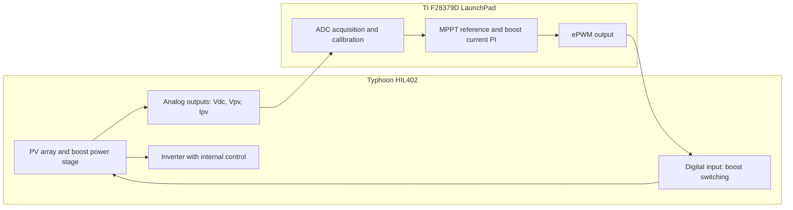
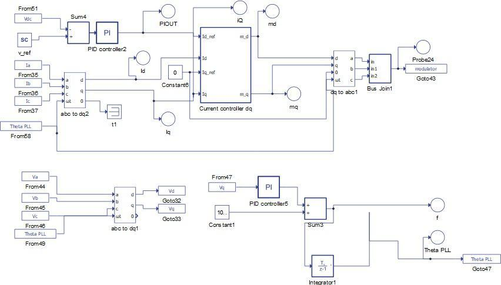
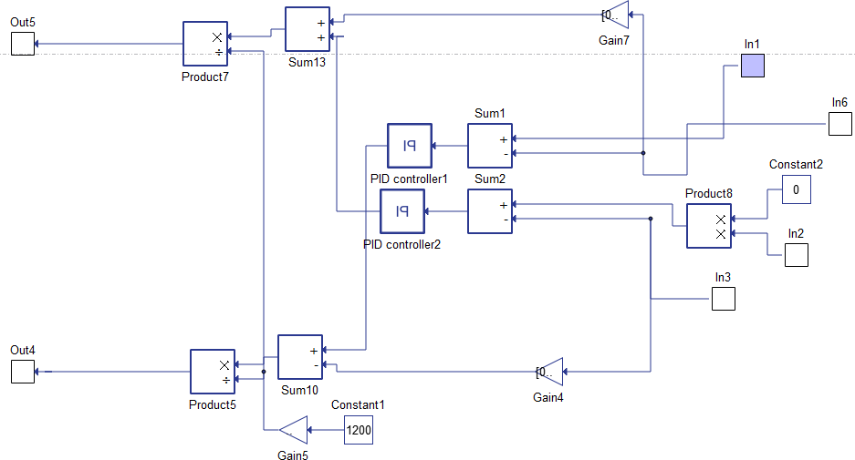
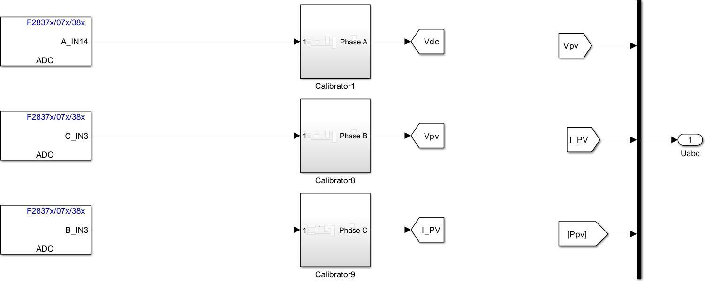
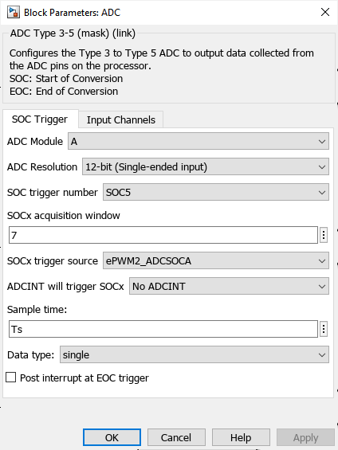
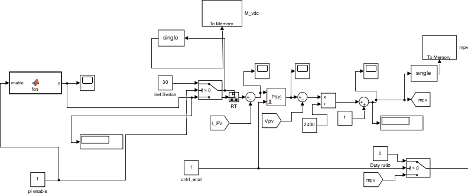
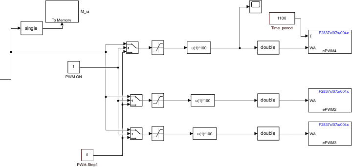

# C2000 implementation and HIL integration

[← Engineering walkthrough](engineering.md) · [Control design & tuning](control-design.md)

The hardware experiment closes the boost-control loop through a **TI Delfino F28379D LaunchPad** and a **Typhoon HIL402**. The electrical power stage runs in HIL; the physical microcontroller acquires feedback and returns a switching command. The inverter controller remains inside the HIL schematic.

## 1. Divide the controller and plant

*Figure 48, p. 93. PV source, boost stage, DC link, Core Coupling, inverter, RL branches and grid are visible.*

The thesis describes **three analog feedback signals and one digital switching connection** (p. 94). This is controller HIL: the MCU drives a simulated power switch, rather than directly switching a physical high-voltage PV converter.

*Figure 49, p. 95. The outer loop compares `Vdc` with the SCADA input `v_ref`; its output feeds `Id_ref`. The q-axis reference is zero. The lower branch supplies the PLL angle.*

*Figure 50, p. 96. Two PI branches, coupling terms and modulation scaling are exposed inside the current-controller subsystem.*

The SCADA reference allows voltage-reference changes during operation, while probes expose the control variables. The repository includes the [schematic](../../HIL-Validation/Schematic%20Model.tse) and [SCADA configuration](../../HIL-Validation/Scada.cus); the screenshots above are the actual PV-system diagrams from the thesis.

## 2. Acquire and scale the feedback signals

*Figure 51, p. 96. Each signal passes through a calibration subsystem before it is used by the controller.*

| Feedback signal | ADC label in the thesis | Calibration subsystem | Role |
| :--- | :--- | :--- | :--- |
| DC-link voltage | `A_IN14` | `Calibrator1` | DC-side voltage feedback/monitoring |
| PV voltage | `C_IN3` | `Calibrator8` | MPPT power calculation and voltage compensation |
| PV current | `B_IN3` | `Calibrator9` | MPPT calculation and current-loop feedback |

These channel assignments also appear in the uploaded `pv_control.slx`: module A / ADCIN14, module C / ADCIN3 and module B / ADCIN3. They identify peripheral inputs, **not LaunchPad header pin numbers**. The thesis does not supply a complete numbered cable map from HIL analog-output terminals to board headers, so that map is not reconstructed from assumption.

### ADC configuration

*Figure 52, p. 97: the ADC A block configuration.*

| Setting | Shown value |
| :--- | :--- |
| Module | A |
| Resolution / input mode | 12-bit, single-ended |
| Start-of-conversion selection | SOC5 |
| Acquisition-window field | 7 |
| Trigger source | `ePWM2_ADCSOCA` |
| Sample time | `Ts` |
| Output data type | `single` |
| Post interrupt at end of conversion | Unchecked |

The explicit ePWM trigger ties conversion requests to PWM events. `Ts` is a model variable; the screenshot does not establish its numerical value. The acquisition-window entry is reproduced as a block setting, not converted into a duration without the peripheral-clock configuration.

## 3. Generate the reference and run the current loop

*Figure 53, p. 97. The accompanying text identifies this as the boost-control implementation, despite the generic “Inventor” wording in the original caption.*

Read the implementation from left to right:

1. A MATLAB Function supplies the reference path; the thesis describes selecting the MPPT algorithm for the experiment.
2. The `Iref Switch` permits a fixed-current reference or the function output. This provides a way to exercise the current loop independently of the tracking decision.
3. The `RT` block connects the reference path to the controller rate.
4. The measured `I_PV` is subtracted from the reference and passed through a discrete PI block.
5. Voltage compensation and normalization form `mpv`, the duty command.
6. Enable and duty-selection signals permit controlled changes between configured operating modes; memory blocks expose values for observation.

The screenshot contains a **2400 normalization constant** and a fixed reference of **30 A**. Those are values in that captured implementation, not replacements for the nominal 1200 V system target or universal settings for every experiment. The thesis explains the mode switches and use of Code Composer Studio on pp. 98–99.

## 4. Convert the duty command into PWM

*Figure 54, p. 98: PWM output path in the embedded Simulink model.*

The visible path includes a PWM enable/stop selection, saturation, multiplication by 100, conversion to `double`, and ePWM blocks. The percentage conversion is consistent with the uploaded model's compare-input configuration. The screenshot labels ePWM4, ePWM2 and ePWM3; the experiment description specifies one digital connection for the boost switching command.

The top branch shows a period input of **1100**. It is not a frequency in hertz. The thesis image alone does not establish the time-base clock, prescalers or physical output pin used for the cable. Accordingly, no unverified switching frequency or header pin is assigned here.

### Timing is part of the implementation

| Timing item | Evidence | Interpretation |
| :--- | :--- | :--- |
| Full-system offline simulation | 10 µs, thesis p. 103 | Numerical simulation step |
| Partial-shading characteristic sweep | 1 µs, Figure 61 | Separate characterization-model step |
| ADC block sample time | `Ts`, Figure 52 | Embedded model variable |
| ADC conversion request | `ePWM2_ADCSOCA`, Figure 52 | Peripheral-triggered acquisition |
| Reference rate transition | `RT`, Figure 53; discussion p. 98 | Boundary between MPPT/reference and control execution rates |

These quantities describe different parts of the system. A simulation step is not evidence of measured firmware execution time or deadline margin.

## 5. Model details behind the screenshots

Static inspection of the original [pv_control.slx](../../Models/pv_control.slx) adds useful implementation detail without modifying or executing it:

- **Target:** TI Delfino F28379D LaunchPad, with the `ert.tlc` code-generation target.
- **ADC channels:** the three named feedback channels match Figure 51. Their configured SOC selections are A/SOC5, C/SOC4 and B/SOC3, all using `ePWM2_ADCSOCA` in the saved model.
- **Calibration:** the three calibration subsystems apply a scale and offset, then convert the result to `single`. This separates raw acquisition from the quantities used by the controller.
- **Observation:** their `To Memory` blocks contain hooks that copy values into Vdc, Vpv and Ipv arrays, supporting the Code Composer Studio observation workflow described in the thesis.
- **Rate transition:** the saved `RT` block declares an output sample time of `1e-05`. This identifies that block's setting; it does not establish the MPPT task's full timing or processor execution time.

Saved calibration constants and source locations

The constants below are repository observations, not newly calibrated coefficients or a claim that the same scaling was used in every recorded run.

| Subsystem | Scale | Offset | Internal SLX system |
| :--- | ---: | ---: | :--- |
| `Calibrator1` / Vdc | 0.077734299 | 2.22187495 | `system_1075.xml` |
| `Calibrator8` / Vpv | 0.827717125 | 0 | `system_1130.xml` |
| `Calibrator9` / Ipv | 0.0827717111 | 0 | `system_1141.xml` |

Each subsystem multiplies the incoming value by its scale and adds the offset. The HIL output scaling and acquisition chain must be reconciled before these constants can be reused on hardware. The archive paths are under `simulink/systems/` inside `pv_control.slx`.

The ADC blocks are in `system_1067.xml`; the `RT` and ePWM blocks are in `system_1342.xml`. Block instance names and peripheral-module selections are not always identical, so the peripheral parameter is the appropriate field to inspect.

## 6. Evaluate the complete loop

The reported HIL tests compare P&O and PSO with uniform irradiance and partial shading. The current traces show whether the controller follows changing conditions and which operating region the tracking objective selects. For the partial-shading comparison, the thesis describes convergence near 45 A with the PV-power objective and near 28 A with the loss-aware objective.

[Open the five HIL scenarios and original traces](results.md#3-controller-hardware-in-the-loop).

The engineering evidence covers acquisition, scaling, reference selection, rate handling, regulation, PWM and observation. The PDF supplies block-level connections and controller settings; it does not supply a complete laboratory wiring schedule, calibration procedure, tuning iteration log or measured firmware timing report. The distinction keeps the presentation useful for technical discussion while preserving the scope of the published work.

[English thesis, experiment implementation](../../Diploma%20Thesis%20-%20English.pdf#page=93) · [Greek edition](../../Diploma%20Thesis%20-%20Greek.pdf#page=93) · [Image provenance](../assets/thesis/README.md)
