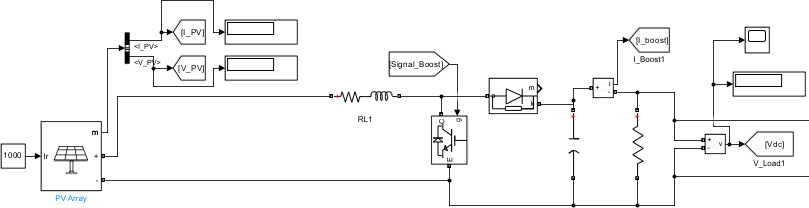
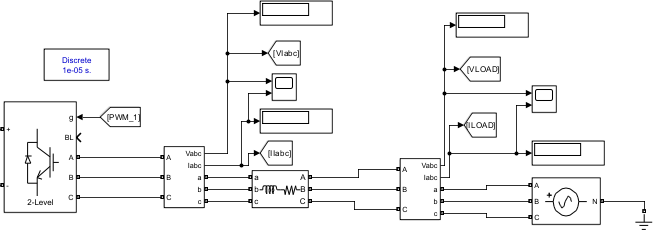
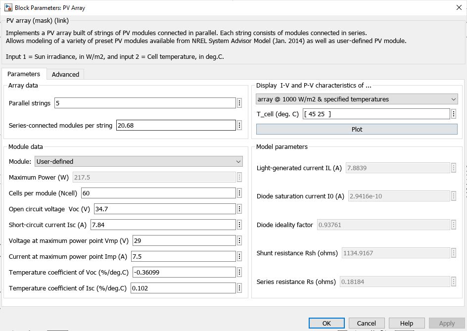
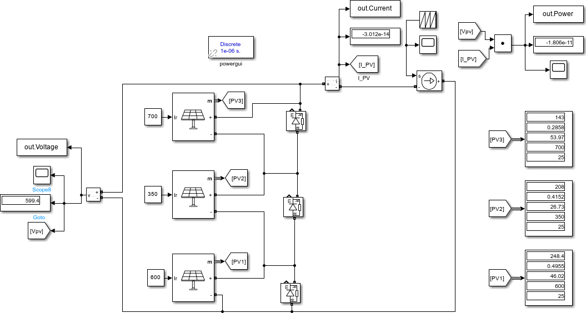
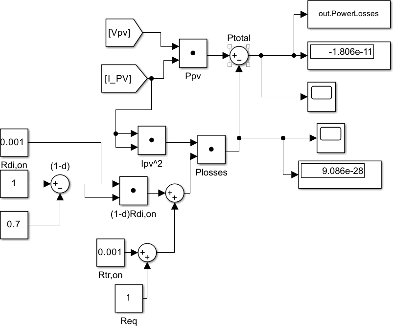
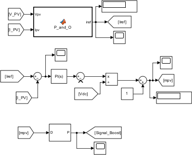
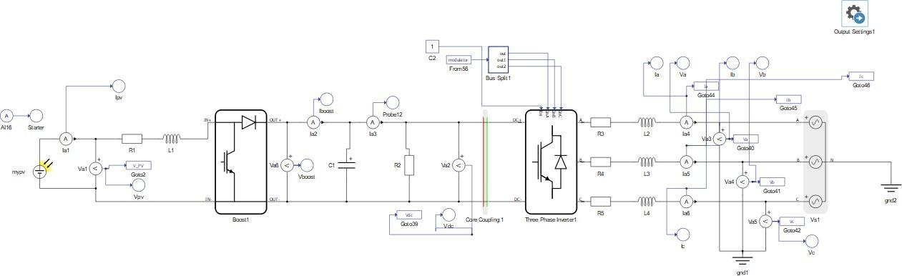

# Engineering walkthrough: from plant model to controller HIL

[← Project overview](../README.md) · [Control design & tuning](control-design.md) · [C2000 & HIL integration](embedded-hil.md)

This walkthrough follows the engineering work behind the MPPT comparison: modeling the electrical plant, defining the optimization objective, designing the control loops, and closing the loop through a physical microcontroller. Figures are extracted directly from the uploaded thesis at their original resolution; click an image to inspect its labels.

## 1. Build the electrical plant

*Thesis p. 102, Figure 56: DC and AC portions of the Simulink system.*

The DC side contains the PV array, series resistance/inductance, controlled boost switch, diode and DC-link capacitor. Measurements of PV voltage and current feed the tracking and control functions. The AC side uses a two-level inverter, a three-phase grid interface and an RL filter, with voltage/current measurements for feedback and power calculation.

This decomposition makes the interfaces explicit: MPPT determines the desired PV current, the boost loop controls that current, and the grid-side loops regulate the inverter operating point. The full simulation described on p. 103 uses a **10 µs discrete step**.

[Open the full grid model](../../Models/pv_grid_control_fullmodel.slx).

### Array parameterization and nominal operating point

*Thesis p. 103, Figure 57: the actual PV block configuration shown in the report.*

| Parameter in the screenshot | Value |
| :--- | :--- |
| Parallel strings | 5 |
| Series-connected modules per string | 20.68, as entered in the equivalent simulation model |
| Cells per module | 60 |
| Module maximum-power voltage / current | 29 V / 7.5 A |
| Module maximum power | 217.5 W |
| Module open-circuit voltage / short-circuit current | 34.7 V / 7.84 A |

The thesis chooses an array voltage near **600 V** for a **1200 V** DC-link target and a nominal boost duty ratio near **0.5**. Using the ideal steady-state relation,

$$V_{dc}=\frac{V_{pv}}{1-d},$$

the model scaling follows as $600/29 \approx 20.68$ module equivalents in series. This is an equivalent-model parameterization, not a physical assembly containing a fractional module. It illustrates the link between array sizing and converter operating point; the ideal relation does not include the modeled parasitic losses.

## 2. Establish the shaded plant characteristics

*Thesis p. 112, Figure 61: the partial-shading characterization model.*

Three PV sections are connected in series, each with a bypass diode and a separate irradiance input. The screenshot shows **700, 350 and 600 W/m²**, from top to bottom. A controlled current source sweeps the operating point, while voltage and current measurements generate the I–V and P–V characteristics.

The screenshot uses a **1 µs** discrete step for this characterization model. That setting is distinct from the 10 µs full-system simulation step and from the embedded controller's timing.

The sweep establishes where the candidate peaks lie before evaluating an MPPT algorithm. This provides a reference against which to interpret convergence: reaching a stable point alone does not show that the selected peak is the best one.

[Open the bypass-characteristic model](../../Models/pv_Bypass_characteristic.slx) · [View the characteristic results](results.md#1-partial-shading-changes-the-optimization-problem).

## 3. Put conversion losses into the objective

*Thesis p. 113, Figure 62: terminal power minus a current-dependent loss estimate.*

The upper branch calculates $V_{pv}I_{pv}$. The lower branch squares current, multiplies it by the loss coefficient and subtracts the result from terminal power. In this particular screenshot, the coefficient is built from $R_{eq}$, $R_{tr,on}$ and $(1-d)R_{di,on}$; the displayed constants are 1, 0.001, 0.001 and $d=0.7$.

Chapter 2 discusses conduction, wiring, diode-drop and switching losses more broadly (pp. 48–51). The pictured characterization block uses a reduced current-squared approximation. The [standalone source guide](implementation.md#integration-details-that-matter) identifies a further difference in the uploaded P&O example. These are distinct implementation levels, so the figure should be read as the specific objective used in that model rather than a complete converter loss model.

The useful engineering result is the change in peak ordering: the largest PV-power peak can lose its advantage once its higher operating current is penalized. [Numerical comparison and plots](results.md).

## 4. Implement and tune the feedback loops

*Thesis p. 104, Figure 58: MPPT provides the reference; the current loop produces the duty command.*

The implementation includes the measured-current error, PI action, PV-voltage compensation, DC-link normalization and PWM generation. The grid-side implementation adds coordinate transformations, synchronization and cascaded voltage/current regulation.

[Read the control derivation, tuning method and numerical PI gains →](control-design.md)

## 5. Close the loop through the microcontroller

*Thesis p. 93, Figure 48: the PV system implemented in Typhoon HIL Schematic Editor.*

The experiment divides responsibility across the two platforms: the LaunchPad supplies the boost switching command through a HIL digital input, while the inverter uses control and modulation inside Typhoon HIL. Three analog measurements return to the controller: PV voltage, PV current and DC-link voltage.

[Follow the ADC channels, calibration, rate transition and PWM output path →](embedded-hil.md)

## Evidence trail

| Engineering stage | Primary thesis evidence | Repository artifact |
| :--- | :--- | :--- |
| Plant modeling | Chapter 3; Figures 56–57, pp. 102–103 | [Full-system model](../../Models/pv_grid_control_fullmodel.slx) |
| Characterization and loss objective | Figures 61–62, pp. 112–115 | [Characteristic model](../../Models/pv_Bypass_characteristic.slx) |
| Feedback design and gains | Chapter 4, pp. 71–79 | [Control design walkthrough](control-design.md) |
| Embedded implementation | Figures 51–54, pp. 96–99 | [C2000 controller model](../../Models/pv_control.slx) |
| Real-time plant and monitoring | Figures 48–50, pp. 93–96 | [HIL schematic](../../HIL-Validation/Schematic%20Model.tse), [SCADA file](../../HIL-Validation/Scada.cus) |
| Performance comparison | Chapter 7, pp. 116–141 | [Results and original traces](results.md) |

[English thesis](../../Diploma%20Thesis%20-%20English.pdf) · [Greek thesis](../../Diploma%20Thesis%20-%20Greek.pdf) · [Image provenance](../assets/thesis/README.md)
